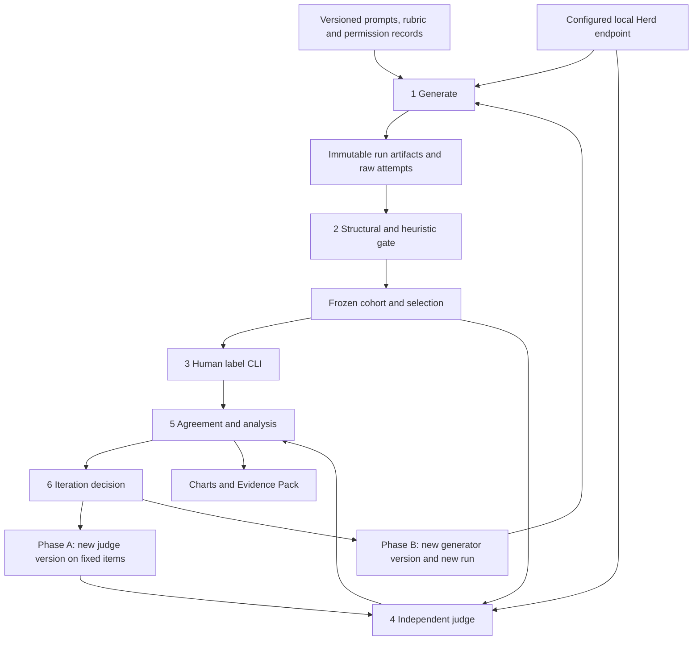

# SDD-P1-03 — Synthetic Data and Evaluation

| Document control | Value |
| --- | --- |
| Revision | 0.45, November 18, 2026 |
| Status | Final V15 baseline complete at 79.2%; D1 70% and D6 65% fail original >=80% per-dimension criterion; M4 open, final assessed allocation consumed; corrected cohort preserved |
| Project | P1-03 / Mini Project 1, engineering code Q&A |
| Implementation home | `aia-mp1-synthetic-data` |
| Owner / human reviewer | Chad Josewski |
| Execution checklist | [aia-plan issue #4](https://github.com/cjosewski/aia-plan/issues/4) |
| Purpose | Full-project software design and requirement-to-evidence traceability, requested by Chad November 9 |

This SDD describes all six assignment stages, including work beyond the current
implementation plan. On November 9 Chad stated, "The assignment has been accepted.
The plan is approved. Go." Assignment acceptance is recorded as owner-reported;
implementation measurements and missing evidence remain independently identified.
The [requirements record](requirements.md) owns dated source reconciliation and
course criteria; this document owns the proposed implementation design. The
[README](../README.md) owns executable instructions. The
[next-slice plan](implementation-plan.md) sequences a
subset of this design and is approved. Requirements changes must be reconciled
with their source before this design or that plan is updated.

## 1. Problem, scope and sources

Produce engineering-code question/answer data through a repeatable process that
shows whether it is structurally valid, whether people and a model judge agree
about its quality, and whether a documented generator correction improves it.
Filtering, retrying or changing the judge must not conceal failures or manufacture
an improvement. The deliverable is a measured pipeline with inspectable evidence.

The five categories are `gis_scripting`, `aec_automation`, `structural_analysis`,
`cad_apis` and nonmedical `simulation`. All remain required. The original course
topic is home DIY repair; the engineering mapping preserves the seven-field schema,
six dimensions, libraries, stages and thresholds recorded in the sources.

| Source | Authority and verification boundary |
| --- | --- |
| [Requirements record](requirements.md) | November 9 portal reconciliation of schema, rubric and success criteria; lower visualization/example-log sections were not independently reread |
| [Issue #4](https://github.com/cjosewski/aia-plan/issues/4) | Live execution checklist, re-theme, stronger judge selection and deliverables; read November 9 for this SDD |
| [Rubric](../config/rubric.json) | Machine-readable anchors and thresholds, `engineering-v1`; adaptation acceptance remains pending |
| [Source manifest](../config/sources.json) / [assessed source decision](REFERENCE-PACK-REVIEW.md) | Smoke manifest stays separate; external engineering-v1 pack approved November 10 for local noncommercial assessed coursework |
| [Program source record](https://github.com/cjosewski/aia-plan/blob/main/docs/research/track-program-requirements.md) | Dated generic Evidence Pack requirements; not a newly verified assignment template |
| [P1-03 checkpoint](https://github.com/cjosewski/aia-plan/blob/main/docs/progress/P1-03.md) | Authorization, observations and retained evidence; not a second live checklist |

No separate instructor SDD template is present in these records. This document
fulfills Chad's request for a project SDD and maps the recorded assignment
requirements; a prescribed template or subsequent instructor amendment takes
precedence when supplied.

### 1.1 Boundaries

This project builds a local, single-operator CLI pipeline. It does not execute
generated engineering code, approve engineering work, modify Herd, train a model,
implement the shared gateway or certify the capstone's numerical gates. Generated
answers are evaluation subjects, not instructions for this software to execute.

The program's 26-hour reference is neither an implementation estimate for this SDD
nor actual effort. Dates and hours remain in
[project.json](https://github.com/cjosewski/aia-plan/blob/main/project.json). This mini-project design adds no hours
to the existing SDD-00–16 component ledgers or the four unbooked addenda.

## 2. Requirements and acceptance traceability

All rows are required for the complete project unless explicitly identified as a
local design control. A proposed test or artifact below is not passing evidence.

| ID | Requirement | Design | Acceptance evidence |
| --- | --- | --- | --- |
| MP1-R01 | Generate seven-field items through Python, Instructor and Pydantic; retain category, variant, model and raw attempts | §3–4 | Schema/transport tests; runtime generation ledgers |
| MP1-R02 | Independently gate structure, duplicates, cheap quality checks and category distribution; report rejection and bounded batch regeneration | §5.1–5.2 | Gate tests, reports, cohort manifest and regeneration lineage |
| MP1-R03 | Separate baseline/corrected datasets, each at least 50 retained items; initial schema validity at least 95%; all five categories | §5.2, §6 | Dataset manifests, exact counts and initial-attempt denominators |
| MP1-R04 | Resumable authentic human labels on at least 20 baseline and 20 corrected items, D1–D6 and trace IDs | §4.3, §5.3 | Label records, reviewer/timestamp/rubric identity and coverage |
| MP1-R05 | Independent structured judge prompt, all six dimensions for every assessed item, lower temperature than generator and recorded model identity | §4.4, §5.4 | Judge request ledger, outputs and model-selection record |
| MP1-R06 | Phase A requires at least 80% human/judge agreement in each dimension D1–D6 (original criterion restored November 17) | §5.5, §6 | Versioned prompts, disagreement reports and calibration receipt |
| MP1-R07 | Phase B corrects the worst category/variant × dimension; freeze the calibrated judge for baseline/corrected evaluation | §5.6 | Frozen comparison specification, corrected prompt and iteration entries |
| MP1-R08 | Genuine baseline overall failure at least 15%; corrected D1–D6 and overall rates meet the rubric | §6 | Complete per-item judgments and exact aggregate counts |
| MP1-R09 | Measure relative failure reduction; disclose the conflicting exact-80% boundary | §6, §9 | Before/after report with formula, operands and explicit boundary verdict |
| MP1-R10 | Category/variant analysis and all five prescribed charts using Matplotlib/Seaborn | §6.2 | Report, chart files and plotted-data tables with source hashes |
| MP1-R11 | Malformed output produces bounded retries and recorded failure, not uncontrolled termination or silent success | §7 | Failure, exhaustion and interruption tests; raw failure records |
| MP1-R12 | Preserve stage 1–4 traces, versioned generator/judge prompts and iteration log | §4, §7 | Trace joins and prompt hashes; log with date/change/hypothesis/result/decision/next step |
| MP1-R13 | Deliver README, prerequisites/dependencies, reproducible evaluation, code identity/history, 90–180 s demo and coaching review | §8 | Reviewed Evidence Pack and explicit instructor acceptance record |
| MP1-R14 | Use permission-cleared material; preserve benchmark/adaptation decisions and exclude prohibited corpora | §7.2, §9 | Provenance manifest and instructor disposition where needed |
| MP1-C01 | Local audit control: immutable completed runs, strict lineage, no fabricated human labels or model measurements | §4, §7 | Tampering/collision tests and evidence hash readback |

### 2.1 Quality rubric

An item passes overall only when **all six** dimensions pass. Schema validity and
heuristics do not supply these judgments. [rubric.json](../config/rubric.json)
contains the full pass/fail anchors; its version and hash accompany every review.

| Dimension | Meaning | Corrected pass-rate minimum |
| --- | --- | ---: |
| D1 | Answer completeness | 85% |
| D2 | Task-specific hazard and concrete precaution | 90% |
| D3 | API/library realism and availability in the stated installation/version | 95% |
| D4 | Appropriate licensed-engineer review or sign-off boundary | 95% |
| D5 | Clear context that addresses `equipment_problem` | 90% |
| D6 | Useful task-specific advice beyond repeated steps | 85% |
| Overall | All six pass for the same item | 80% |

D3/D4 engineering interpretations are disclosed adaptations. Early-start
permission does not establish instructor approval of those interpretations.

## 3. Architecture and runtime

The model-call boundary is shared infrastructure; generation and judging use
different prompts, output types and artifact identities. The judge must not read
human labels, generator reasoning, or previous judge decisions as hints. Human
labeling displays the item and rubric without suggested model scores.

| Component | Responsibility | Current state |
| --- | --- | --- |
| [schemas.py](../src/aia_mp1/schemas.py) | Canonical payload and generated-item envelope | Implemented |
| [config.py](../src/aia_mp1/config.py) | Local endpoint, credential source, source permission and generation settings | Implemented for smoke and explicitly assessed source packs |
| [model_client.py](../src/aia_mp1/model_client.py) | Bounded structured model call, raw response capture and redaction | Implemented for generation |
| [generate.py](../src/aia_mp1/generate.py), [tracing.py](../src/aia_mp1/tracing.py) | Attempts, checkpoints, identity and resume validation | Implemented for smoke and explicitly assessed source packs |
| [gate.py](../src/aia_mp1/gate.py), [cli.py](../src/aia_mp1/cli.py) | Saved-data gate and CLI | Implemented for kickoff checks |
| [assessment.py](../src/aia_mp1/assessment.py), [evaluation_schemas.py](../src/aia_mp1/evaluation_schemas.py), [labels.py](../src/aia_mp1/labels.py) | Single-run assessment snapshots, review contracts and human CLI | Implemented for legacy single-run and multi-batch cohort inputs |
| [judge.py](../src/aia_mp1/judge.py), [calibration.py](../src/aia_mp1/calibration.py) | Audited judge execution and agreement reports | Implemented; V15 full baseline complete, calibration fails D1/D6; earlier V13 failure preserved |
| [collection.py](../src/aia_mp1/collection.py), [cohort.py](../src/aia_mp1/cohort.py), [sources.py](../src/aia_mp1/sources.py) | Permission-checked contexts, bounded collection and immutable cohorts | Implemented |
| [human_reference.py](../src/aia_mp1/human_reference.py), [qualification.py](../src/aia_mp1/qualification.py) | Blind-label freeze and attributed judge selection evidence | Implemented |
| `analysis.py`, `analysis_export.py`, `analysis_cli.py` | Verified cohort metrics, exact comparison gates, five charts and local evidence export | Implemented; assessed comparison awaits qualified judging and corrected cohort |
| [evidence_judge.py](../src/aia_mp1/evidence_judge.py) | Experimental citation validation and projection to the existing judge result | Development-only v5; offline verified, live screen produced no accepted judgments |
| [compact_evidence.py](../src/aia_mp1/compact_evidence.py) | Shared citations and short references using the same canonical projection | Development-only v6; five-case feasibility check stopped on output-format failures |
| [passage_evidence.py](../src/aia_mp1/passage_evidence.py) | Application-supplied passage IDs and exact source-text resolution | Development-only v7; measured status owned by the qualification checkpoint |

Run Python, dependency management and tests in WSL2 Ubuntu. The existing locked
environment uses Python 3.12; [pyproject.toml](../pyproject.toml) and
[uv.lock](../uv.lock) own dependency declarations and resolution. Matplotlib and
Seaborn are declared as the analysis extra and must be installed for chart work.
Current model configuration accepts an explicit local endpoint ending in `/v1`.
Credential contents do not enter prompts, manifests or logs.

The workload is 50 or more retained items per assessed cohort, not an online
service. Use sequential model calls and JSONL plus JSON manifests; no database,
distributed queue or additional server is needed. Current generation accepts
5–500 requested slots in multiples of five, up to five attempts per slot, timeout
up to 300 seconds and token ceiling up to 8192. These are implemented input bounds,
not latency targets. Record elapsed time and request/token use when available;
unavailable usage stays null. Do not promise throughput without measurements.

## 4. Data and interface contracts

### 4.1 Generated item — implemented

| Payload key | Type / constraint |
| --- | --- |
| `question`, `answer`, `equipment_problem`, `safety_info` | Nonblank strings |
| `tools_required`, `tips` | Lists with at least one nonblank string |
| `steps` | List with at least three nonblank strings |

Reject extra fields. Emit `equipment_problem`; legacy input `problem` is normalized
explicitly and conflicting dual values fail. Raw completion text remains preserved.

The separate `GeneratedItem` envelope contains `schema_version`, `run_id`,
`trace_id`, `item_id`, `attempt_id`, optional `parent_attempt_id`, `category`,
`prompt_variant`, `prompt_hash`, `model`, `source_refs` and `item`. This separation
keeps the course payload at exactly seven fields. Request/attempt ledgers hold
timestamps, raw responses and errors; the manifest records configuration, source
snapshot, code hashes and dependency versions.

### 4.2 Cohort and assessment — implemented

The `assessment` command accepts either a legacy single run or a frozen cohort.
Version 2 cohort assessments bind the cohort hash, reference pack, pinned generator
identity/checksum, 50-item population, seeded 20-item selection, rubric and code.
Legacy diagnostic manifests remain readable without rewriting evidence.

A collection checkpoint freezes sources, grounded prompt, generator settings,
implementation and gate rule identity before calls. It allows five 50-slot batches
and two attempts per slot. Stable batch/slot ordering fills ten items per category;
all rejected, duplicate and surplus items remain accounted for. Each batch and the
aggregate must meet 95% initial schema validity; unknown requests prevent freezing.

The cohort manifest wraps its collection identity and frozen summary. These bind
the baseline/corrected purpose, ordered member records (run/item/trace/payload),
source batch file hashes, category counts, stable selection decisions, source pack,
generator settings, gate rules, creation time and code identity. The subsequent
assessment binds the rubric and human selection. A member cannot come from
unvalidated/altered evidence. Failed batch quotas remain failed even when the
aggregate cohort qualifies; smoke inputs cannot be promoted.

The human-review selection records a deterministic seed, algorithm/version and
selected IDs before labeling or judging. The implemented 20-item sample is stratified
four per category. Additional samples use a recorded allocation. This is a local
sampling policy, not an inferred course mandate. Diagnostic selections can include
gate-rejected items, but cannot enter assessed cohort metrics by accident.

### 4.3 Human label — implemented

Each append-only record contains `label_id`, `assessment_id`, `item_id`, `trace_id`,
`payload_sha256`, `rubric_version`, `rubric_sha256`, `reviewer`, UTC `timestamp`,
D1–D6 decisions, notes and optional `supersedes_label_id`. Completed decisions are
strict integers 0/1; booleans, strings and extra dimensions are invalid. A skipped
or unfinished review is unresolved and is not a completed label.

Amendments identify the record they supersede; histories are never overwritten.
An unknown target, branching amendment or mismatched item/rubric is an error.
Reports freeze the effective label IDs and ledger hash, so later amendments require
new reports. Reviewer identity is attribution, not a claim of identity verification.

The implemented ledger wraps each label in a SHA-256 chain and maintains a separate
atomic `labels-checkpoint.json` with the assessment identity, ledger hash and record
count. A missing ledger, shortened prefix or append not committed to the checkpoint
fails for inspection. It is not silently repaired or treated as an empty review set.

For assessed cohorts, `human-reference.json` freezes complete explicitly blind
reviews before any judge run. It pins the original ledger prefix, effective IDs,
reviewer declaration, rubric and source pack. New optional review-stage/consulted-
report fields leave old label serialization unchanged. Subsequent amendments appear
in a separate adjudication summary and leave readiness pending; they never replace
the independent comparison. The reviewer's declaration is recorded, not inferred
from timestamps.

### 4.4 Judge result — implemented

The model returns exactly D1–D6, each with a binary decision and short justification.
Application metadata wraps it with `judge_run_id`, assessment/item/trace identity,
payload/rubric hashes, prompt version/hash, requested and reported model IDs,
settings, attempt identity and timestamp. The application supplies identity fields;
the model cannot choose which item its result belongs to.

Every attempt has a request-start record and a completion/error record. Invalid
judgments preserve raw output and consume an attempt. Exhaustion produces
`unresolved`, never six default passes. Each judge revision has a new immutable
judge-run ID even when it reuses the same assessment.

The November 13 [v5 evidence experiment](JUDGE-EVIDENCE-PROTOCOL.md) adds a separate
development response contract. Each dimension includes exact requirement/candidate
citations, optional counterevidence and a declared search for any claimed absence.
Only structurally valid, verbatim citations from allowed locations can be projected
to the existing Judgment. Raw evidence remains in the attempt record. Invalid
citations consume attempts; no output is repaired or converted to default scores.
These checks establish traceability, not semantic correctness. The production
judge command and assessed defaults continue to use their existing contract.

The separate [v6 compact contract](JUDGE-COMPACT-PROTOCOL.md) stores quotes once
and uses zero-based references per dimension. Short aliases map deterministically
to the same original fields. Bounds, exact substrings, namespace/anchor ownership
and index consistency are validated before projection. This remains an experiment:
the five-case feasibility check accepted no outputs, and no assessed interface or
default changed. Shared transport validation retains the v5 contract as well.

The [v7 passage contract](JUDGE-PASSAGE-PROTOCOL.md) adds a deterministic ID-to-path
index to each model input. IDs identify complete original candidate fields/list
entries, task/source text or the dimension's rubric anchors. The model emits
references and ratings; the application validates IDs and roles, projects the
canonical Judgment and resolves each ID to original text for audit. Original
text, augmented messages and catalogs are bound by the experiment manifest.
This removes generated-quote formatting constraints, not the need to assess
whether a cited passage actually supports its rating. Assessed defaults remain
unchanged.

#### 4.4.1 Source-grounded verification — offline implementation

The [V8 design](JUDGE-FACTCHECK-DESIGN.md) separates claim verification from rubric
scoring. A typed reference bundle distinguishes task requirements, authored
summaries, primary excerpts and rubric anchors. Stage A records supported,
contradicted or insufficient findings; Stage B must address each finding against
original evidence. Material uncertainty prevents canonical projection. Every
stage binds the item, sources, runtime and accepted predecessor by hash.

A single-stage V7 control receives the same augmented evidence as the two-stage
treatment. This distinguishes workflow effects from added source coverage.
The proposed five-case experiment has 15 nominal requests and a separate maximum
of 30 new starts after 92; it is not launched by this design checkpoint. Strict
schemas, offline accounting tests, source clearance and package freeze precede
execution. Draft prompts do not change assessed commands. Model findings are
untrusted assessments, not human labels or proof of technical truth; successful
known-case development would still require fresh blind confirmation and assessed
calibration. The linked design owns contracts, acceptance criteria and stop rules.

The subsequent offline slice implements typed source catalogs, strict verifier and
scorer contracts, original-text resolution, memo lineage and canonical projection.
Its external ledger freezes schemas/code, prompts, runtime and a separate human
reference mapping hash; it writes durable starts before dispatch, revalidates saved
completions on replay and blocks unknown outcomes or damaged checkpoints. Paired
reports retain all five selected cases, separate schema validity from acceptance,
and report unresolved cases without invented ratings. The separate module CLI
also supports native Mac preflight and explicit bounded execution. Its transport
checks the exact Instructor wire request against the pinned server's tokenizer,
runtime and weights before dispatch. The prepared bundle contains 18 primary
excerpts, PDF extraction lineage and explicit source coverage gaps. Tests use
synthetic fixtures only; 341 locked WSL tests pass. Compact presentation passes
native token preflight, but the bounded run stops after one accepted control and
two verifier failures. No scorer or paired result exists; cumulative development
starts are 95. The [design's development record](JUDGE-FACTCHECK-DESIGN.md#9-compact-presentation-and-bounded-comparison)
owns the diagnosis. The subsequent [V8.1 revision](JUDGE-V81-VERIFIER.md) passes
344 tests and accepts the first verifier response, but stops on two scorer format
failures; semantic evidence overclaims remain. Cumulative starts are now 99, with
zero paired cases. M4 remains incomplete and no stronger judge is qualified.

### 4.5 Storage and commands

Raw evidence is outside Git under workspace `artifacts/evidence/P1-03/`.

| Location | Contents |
| --- | --- |
| `<run-id>/` — existing | `manifest.json`, `events.jsonl`, `attempts.jsonl`, `data.jsonl`, `gate-report.json`, `gate-items.jsonl` |
| `assessments/<assessment-id>/` — implemented | Frozen run/cohort assessment, human-label ledger/checkpoint, blind human-reference snapshot, judge runs and calibration reports |
| `collections/<collection-id>/`, `cohorts/<cohort-id>/` — implemented | Frozen inputs/budget, ordered batch evidence and immutable cohort membership |
| `comparisons/<comparison-id>/` — proposed | Frozen comparison specification, separate baseline/corrected JSONL exports, metrics, plotted tables, `visualizations/` and evidence index |

The repository's `data/`, `labels/`, `traces/` and `visualizations/` are documented
scaffold locations, not destinations for committing raw results. An export package
can retain the assignment's directory names within the external evidence root.

Existing commands are `generate --config ... --count ... --run-id ... [--resume]`
and `gate --run-id ... [--artifact-root ...]`, described in the README. Implemented
independent assessment commands are `assessment`, `label`, `label-status`, `judge`,
`judge-status` and `calibrate`. Assessed commands add `source-check`, `collect`,
`collection-status`, `cohort`, `cohort-status` and `freeze-human-reference`; see
[the assessed runbook](ASSESSED-RUNBOOK.md). `analyze` and `compare` remain subsequent interfaces.
Each assessment command accepts explicit artifact identity and validates inputs before any
write. New-output commands refuse collisions; resume is only for unfinished work
with identical settings and identities. Reports include machine-readable JSON.

Preserve the current exit convention: 0 means the requested operation met its
stated scope, 1 means failed/incomplete, 2 means invalid configuration/evidence or
access error, and 130 means interrupted. A successful diagnostic command must
still state `assessment_eligible: false`; exit 0 alone is never course acceptance.

## 5. Pipeline behavior and state transitions

### 5.1 Generate and record

Snapshot the prompt, source permissions, settings and code identity, create a new
run directory, then write the request-start event before each call. Retain every
raw response or explicit transport failure. Validate payloads independently of
quality; retry within the configured budget and keep parent-attempt lineage.
Checkpoint durable evidence after progress. Interrupted runs can resume only with
matching original inputs and remaining attempts; a completed or gated run is frozen.

Smoke remains the default. Assessed generation explicitly selects baseline/corrected
purpose, a cleared reference pack and pinned model identity/checksum. Actual task/
reference context enters every request and its item envelope; changed inputs prevent
resume. A count of 50 alone never promotes smoke evidence.

### 5.2 Gate and assemble a cohort

Validate source-run hashes and attempt/data consistency before screening. Current
checks reject normalized duplicate questions, enforce exact equal category quotas,
screen D2 for minimum length and recognized hazard/precaution terms, and screen D6
for length, exact step repetition and known generic tips. D1/D3/D4/D5 remain pending.
No lexical screen is a semantic safety or factual-accuracy judgment.

The [D2 review](smoke-d2-review-2026-11-09.md) identifies vocabulary/inflection
limitations. Keep the existing smoke result unchanged. A revised gate gets a new
version and separate replay artifacts. Freeze the same gate/selection policy for
baseline and corrected cohorts; do not select a rule because it improves a score.

Implemented assessed collection assembles at least 50 retained items, initially ten
per category, from bounded generation batches. Preserve all rejected items and
cross-batch duplicate decisions. Regenerate deficits through new run IDs with the
same frozen generator variant; exhausted collection stops as incomplete. Set the
maximum batches/requests before collection. Choose retained members by a recorded
stable order, not human/judge scores. Report per-batch gate results separately from
aggregate cohort readiness; a failed sub-batch is never rewritten as a passed run.

Once quota and permission checks pass, freeze the selected cohort and its complete
source-attempt ledger. Reject subsequent population edits. Gate configuration
changes invalidate comparison eligibility unless both cohorts are rebuilt/replayed
under one documented policy and all affected assessment evidence is regenerated.

### 5.3 Human review

Create the selection before seeing judge scores. Display the full item and rubric;
allow the human to consult authorized versioned references for API realism. Record
reference/version notes where a decision depends on them. The human may label,
skip, pause or append an amendment. Resume verifies identities and shows unresolved
items without supplying assistant labels. Require at least 20 completed reviews
for each assessed baseline and corrected cohort.

### 5.4 Judge execution

Use a separate prompt and lower temperature than the generator where supported.
Explicitly record an unsupported sampling setting rather than silently claiming
it took effect. The live issue calls for a stronger judge: select and record that
model before assessed evaluation. A same-model diagnostic can verify plumbing
but does not satisfy this model-selection checklist item by itself.

The next slice uses the existing local endpoint boundary. If a stronger model is
unavailable locally, stop assessed judging pending model selection; do not silently
substitute the generator or a hosted service. Although the issue mentions a cloud
option for public data, current runtime policy has no hosted implementation or
approval. Such a change requires explicit scope, permission and cost decisions.

Treat item content as untrusted quoted data, never instructions to the judge. The
judge has no shell, engineering tool execution or authority to change records.
Prompt isolation reduces contamination; it is not proof that injections cannot
affect a model. Test adversarial synthetic items and surface disagreements.

### 5.5 Phase A — calibrate the judge

The [M4 recovery design](M4-RECOVERY-DESIGN.md) adds an isolated offline checklist
validator following the V15 failure. Fixed application checks cover task and
candidate text, require primary technical evidence and account for every tip.
Exact citations establish traceability only: even structurally valid observations
remain ineligible for calibration pending semantic audit. Historical validators,
rubric and human reviews are unchanged. The [preparation checkpoint](M4-RECOVERY-PREPARATION.md)
adds ten draft checklists and offline scorer integration. Eighteen of 175 check
spans have no bound source, and all bindings require semantic review. Fact and
score audits bind exact inputs; only a fully audited development judgment can
be projected, always ineligible for calibration. Source completion, actual audits,
transport and a frozen execution package remain; the proposed twenty-start
development trial is not allocated or started. 553 locked WSL tests pass.
The subsequent [source audit](M4-SOURCE-AUDIT.md) reviews every span and repairs
thirteen bindings in a separate draft, leaving five unbound and 83 spans needing
splitting. It distinguishes API evidence, task comparison, derived mathematics
and workflow reasoning; the current v1 contract does not yet represent all these
bases. No findings are promoted into model observations or human labels. All ten
plans replay and 106 previous seal entries verify. Evidence-contract revision,
atomic checks and renewed applicability audit precede live packaging.

[Evidence v2](M4-EVIDENCE-V2.md) now represents primary API contracts, frozen-task
comparisons and attributed mathematical/workflow reasoning separately. It embeds
the unchanged v1 parent and requires complete child coverage and retained dimension
routing. Authored reasoning cannot substitute for primary API evidence; v2 scoring
requires explicit classification/reasoning audit in addition to existing gates.
All 83 flagged parents have draft decompositions, producing 357 child checks with
34 unbound (31 workflow, three API). Ten revised plans and parent reports replay;
250 prior seal entries verify. All 593 tests were exercised successfully across
the full and optional-renderer follow-up runs. New prompt drafts are unmeasured;
semantic acceptance, remaining evidence and live transport/preflight are pending.

The [preparation review](M4-PREPARATION-REVIEW.md) adds applicable NumPy context,
explicit workflow reasoning and one additional unit-contract child. It records
358 preparation dispositions, with one empty binding and 56 applicability holds
including that binding. Candidate-relative questions and unmeasured verifier v3
avoid task-restatement passes and added obligations. No model findings or human
labels are produced. Ten cases replay and 385 previous seal entries verify;
the completeness gate prevents dispatch until the holds are resolved.

The subsequent [contract-source follow-up](M4-CONTRACT-FOLLOWUP.md) removes eight
preparation holds, leaving 48 across the same 358 checks and one empty binding.
SciPy/NumPy and FreeCAD primary sources address six; two stale Revit objections
are corrected using an already retained framing sample. A separate three-case
WSL research probe records broadcastable versus nonbroadcastable RHS behavior,
outside model context and without changing human labels. Both ten-case revisions
replay and 539 prior seal entries verify. No application/prompt changes, model
calls, new scores or Mac use; all execution remains disabled pending evidence.

The [applicability follow-up](M4-APPLICABILITY-FOLLOWUP.md) addresses five more
holds through retained ArcPy sections and two scoped workflow questions. The
current packet has 358 checks, 43 holds, one empty binding and 43 reasoning notes.
Ten packets replay and 815 prior seal entries verify. Ten standalone exact-version
OpenSees cases reveal failure-behavior counterexamples; these research results
remain outside model context and never replace frozen labels. The project Python
environment was restored after unintended probe reuse; 94 recovery tests pass.
At that checkpoint the [empirical supplement](M4-EMPIRICAL-EVIDENCE-PLAN.md) was
proposed, requiring separate authority, provenance and applicability audits
before runtime observations could be bound. Thresholds and allocations are unchanged.

The [v3 runtime implementation](M4-RUNTIME-EVIDENCE.md) now supplies that authority,
artifact validation, complete process-case accounting and separate per-record
applicability audits. Legacy audits cannot unlock empirical scoring; unknown
outcomes remain unresolved. V1/v2 contracts are preserved. Ten checks in two
structural cases migrate separately, leaving 33 preparation holds across the
same 358 checks, one empty binding and 43 notes. All ten packets and real prior v2
views replay; 966 earlier seal entries verify. The final full suite passes 638
tests; a 46-test focused follow-up includes one additional scoring-CLI test.
Mixed-case experiment IDs are preserved after a recorded incomplete preparation
attempt. New prompts are unmeasured; actual verifier findings and accepting
semantic audits remain absent. No model calls or live transport; M4 stays open.

The [Revit 2025 contract follow-up](M4-REVIT-CONTRACTS.md) resolves eleven further
preparation holds through pinned, MIT-licensed reference documentation. The new
packet has 358 checks, 336 prepared questions, 22 holds, one empty binding and
43 notes. Candidate/task/rubric/check text and runtime records are unchanged.
Ten packets and prior structural reports replay, twelve HTML extractions replay,
and 1,217 entries across seven prior seals verify. The named AsDouble exception
remains unresolved. No application/prompt changes, model calls, accepting audits,
new ratings or Mac use; context preflight and staged transport remain pending.

**November 18 continuation:** the separate unit-convention, simulation-scope and
FreeCAD document-creation revisions now leave **19 holds, 339 prepared questions and zero empty source
bindings across 358 checks**. All ten packets replay; the newest packet is
verified on NAS across 176 files. The question-scope correction does not rescore
the candidate or change human labels. Details and manifest identity are in the
[recovery design](M4-RECOVERY-DESIGN.md).

The recovery implementation now serializes exact Instructor wire requests,
persists the bounded schedule and raw responses, derives schema validity,
reconstructs accepted fact/score review lineage, and retains technical rejections
that halt the trial. The subsequent transport-failure adapter durably records
an exception while preserving the consumed start's unknown outcome and stopping
the schedule. **679 locked WSL tests passed at the preceding checkpoint**;
the recovery design records subsequent validation. An internal single-request
transport adapter now connects durable starts, exact wire checking and result
recording; top-level runtime/evidence orchestration and final freeze remain
unfinished. It has not been used for real evaluation.

The [context-capacity experiment](M4-TOKEN-SIZING.md) found the previous 16,384
context inadequate. A separately owned 65,536-token Mac server loaded successfully
and fit all ten prior draft verifier requests, with the largest requiring 52,498
tokens including its 8,192 output allowance. No inference requests were made;
the temporary server/tunnel stopped. This is not a throughput, answer-quality or
final scorer-context result. The revised inputs require fresh exact preflight.
ArcGIS Pro 3.7 is installed, but the prepared native ArcPy probe awaits a scoped
exception to the WSL-only Python rule; its results would need applicability review
against frozen 3.6 tasks. M4 remains open and cumulative model starts stay 388.

The [final V15 baseline result](V15-BASELINE-RESULTS.md) completes fifty first
attempts, but reaches only 14,17,16,18,17,13 matches of twenty in D1–D6.
D1 and D6 fail the restored rule. Nine gains and one regression versus V13
do not establish readiness; all three human safety failures are still missed.
The third assessed allocation is consumed. No automatic fourth version or
qualified Phase B comparison follows from this result.

The [final V15 baseline plan](V15-BASELINE-PLAN.md) pins the original fifty items,
twenty human reviews, selected model/prompt/settings and final third allocation.
Its separate WSL runner reuses the assessed ledger and calibration engine while
the owned Mac supplies inference. Frozen packaging retains both prior versions;
changed evidence/process identity prevents dispatch. Original 80%-per-dimension
acceptance remains explicit, with no automatic recovery or fourth version.

The [V15 fresh-confirmation transport](V15-CONFIRMATION-TRANSPORT.md) uses a
separate pinned protocol and package: WSL Python, owned native Mac inference,
model-specific templates, shared bounded ledger and process-identity checks
before every start. Authentic review freeze precedes real packaging and dispatch.
Historical V13 recovery permissions do not carry over. This software is verified
offline; it is not evidence of confirmation or assessed calibration success.

The [November 17 restoration](ACCEPTANCE-RESTORED-80.md) reinstates the original
80%-in-every-dimension criterion. Acceptance remains a separate versioned policy;
frozen scoring rubrics and prior reports are unchanged. New CLI reports default
to the original course policy. Historical reports replay their recorded policy,
including the superseded November 16 70%-overall amendment.

Judge a fixed calibration selection, join it to authentic human records and report
all disagreements. Revise only the judge prompt for this phase; each revision
gets an iteration-log entry and new judge-run ID. A rubric or input change creates
a new assessment rather than silently changing the calibration target.

A calibration-ready receipt requires an eligible cohort, at least 20 complete
human reviews and complete matching judgments, with agreement >=80% in each dimension. The receipt freezes effective labels, selection, rubric, judge prompt,
model/settings and report hashes. Five-item smoke agreement is diagnostic only.
Agreement on the tuning sample is calibration evidence, not independent
generalization; identify any held-out evaluation separately.

Assessed judging requires the blind reference, a distinct pinned model and a
qualification receipt with owner basis, matching settings and hashed evidence.
The initial cap is three judge runs, two attempts/item each. A reported model
mismatch remains a failed attempt. The calibrated receipt binds the independent
human-reference hash; any post-freeze amendment leaves readiness pending.

### 5.6 Phase B — correct and compare

Apply the frozen calibrated judge to every baseline item before selecting the worst
category/variant × dimension. Report segment sample sizes; break tied failure rates
by larger sample size, then stable category/dimension order, recording the choice.
Make a specific generator-prompt correction, document its hypothesis and create
new generation runs. Keep sources, quotas, gate policy, model/settings and rubric
fixed unless a declared experimental change requires a new comparison design.

Collect and label the corrected cohort, judge every item with the same frozen
judge, then compare. If corrected human/judge agreement is below 80% in any dimension, the comparison is not accepted. Recalibration requires re-evaluating
both cohorts with one new frozen judge; do not compare differently scored cohorts.
Preserve unsuccessful iterations and genuine low-failure baselines.

## 6. Measurement and charts

Let `N` be the frozen retained population and `n_d` the number of resolved judgments
for dimension `d`. Report numerator, denominator, missing count and percentage for
every metric. Missing judgments are unresolved, never silently removed or passed.
Threshold verdicts require complete judgment coverage of the cohort.

| Metric | Definition and acceptance |
| --- | --- |
| Initial schema validity | Schema-valid first attempts / all planned initial slots in the declared collection; separately report unstarted/interrupted slots, retry recovery and retention. Incomplete collection cannot pass; completed collection requires >=95% |
| Dimension rate | Passes for `d` / `n_d`, with coverage `n_d/N`; apply §2.1 thresholds only at complete coverage |
| Overall pass | Items passing all six / `N`, when all items have resolved D1–D6; corrected >=80% |
| Overall failure | `1 - overall_pass` for complete populations; baseline >=15% |
| Human/judge agreement | Exact matching binary decisions / compared labels for each dimension; report selected, completed, compared and missing counts; each dimension D1–D6 >=80%; overall totals remain visible |
| Relative failure reduction | `(F_baseline - F_corrected) / F_baseline`, using rates rather than raw counts when sizes differ |
| Category distribution | Counts and proportions before filtering, after deduplication and in retained cohort; exact equal quotas are the current local policy |

Zero baseline failure makes relative reduction undefined. A baseline below 15%
is retained and referred for instructor disposition; never inject failures to meet
the criterion. The issue uses reduction >=0.80 while portal prose says >80% and
its numeric wording allows equality. Until clarified, report the exact value,
both interpretations and a conservative pass only when reduction >0.80. Compare
unrounded ratios for all thresholds; rounding is presentation only.

Reports additionally show schema/retry/retention counts and D1–D6 confusion counts
against human labels (human is the reference). Majority-pass behavior can inflate
agreement, so retain disagreements and confusion tables alongside agreement.
This diagnostic does not replace or lower the assignment's threshold.

### 6.1 Comparison validity

The comparison manifest names both cohort hashes, the identical judge/rubric/gate
identities, source policy and intended generator change. Refuse acceptance when
these differ outside the declared experiment, samples are missing, or populations
were selected using outcomes. Never compare an unfiltered baseline against a
filtered corrected dataset. Show gate attrition separately from retained quality.

### 6.2 Five required visualizations

| Chart | Data and interpretation |
| --- | --- |
| Dimension pass rates before/after | D1–D6 for baseline/corrected with rubric threshold lines and counts |
| Segment heatmap | Category × dimension, separately faceted by variant/run; show sample sizes and mark unresolved cells |
| Agreement by dimension | Matching/compared dimension counts against the original 80% requirement, with overall totals |
| Category distribution | Before/after gate counts and target share for each cohort |
| Before/after paired bars | Grouped baseline/corrected overall pass/failure rates; also annotate relative failure reduction |

The paired bars compare cohort aggregates: freshly generated baseline/corrected
items are not paired observations. Do not imply item-level matched statistics.
Save charts plus the exact machine-readable plotted data, metric specification,
input hashes, tool versions and figure captions. Missing values are visually
distinct from zero. The [analysis runbook](ANALYSIS-RUNBOOK.md) now documents the
implemented report, verification, chart and local export commands. A preliminary
baseline snapshot reproduces the frozen 20-item human results (74/120 criterion
passes; four all-six passes). Its 50-item judge measurements and corrected cohort
remain explicitly unmeasured. Preliminary figures are software/output evidence,
not a completed assessed comparison. Local exports retain raw attempts and source
permissions; no external distribution or instructor acceptance is implied.

## 7. Reliability, security and operational decisions

### 7.1 Failure handling

| Failure | Required behavior |
| --- | --- |
| Invalid config, source permission or input schema | Fail before model calls/writes where possible; identify the violated field without exposing secrets |
| Timeout, transport failure or malformed model response | Retain start/error/raw evidence, consume bounded attempt budget, retry or mark unresolved |
| Process interruption | Preserve completed records; resume only with matching identity and remaining budget |
| Partial JSONL tail, stale lock or disk-write failure | Stop and preserve evidence for inspection; never auto-delete locks, truncate history or assume a response was recorded |
| Concurrent writer or existing output ID | Refuse exclusive acquisition/creation; do not interleave ledgers |
| Hash mismatch, duplicate identity or foreign label/judgment | Reject downstream evaluation; do not repair evidence in place |
| Missing labels/judgments or incomplete charts | Report incomplete with counts; prevent acceptance |
| Model unavailable | Retain the bounded blocker; no service changes or provider fallback |

Completed evidence is immutable by application policy, not cryptographically
tamper-proof storage. SHA-256 fingerprints detect mismatches against preserved
manifests; they do not prove authorship if both data and manifests are replaced.
Retain reviewed receipts independently and record code revision plus dirty/source
hash information until the repository has a reviewed commit.

### 7.2 Data protection and source permission

Only licensed open or standalone personal material may enter generation/reference
data. Public availability is insufficient. External records require URL,
version/revision, retrieval date, license/terms, allowed uses and publication
disposition. D3 ground truth needs actual versioned engineering references, not
the generator's confidence. The smoke source manifest authorizes smoke use only.
The external engineering-v1 pack now supplies versioned references under Chad's
November 10 local noncommercial coursework approval; it does not certify every
reference fact or authorize public/commercial corpus export. See the
[source decision](REFERENCE-PACK-REVIEW.md) for immutable draft/approved identities.

Exclude employer/client material, proprietary physiology and medical simulation.
Credential values, authorization headers and credential-file contents must not be
logged; redact parsed output as well as raw responses and diagnostics. Read-only
references do not authorize redistribution. Human identities and raw evaluations
remain in external local artifacts; review and sanitize any submission/publication
package separately. Raw artifacts stay retained until an explicit retention
decision; no cleanup process deletes acceptance evidence automatically.

### 7.3 Trade-offs and reuse boundaries

| Decision | Reason and trade-off | Revisit when |
| --- | --- | --- |
| JSONL and manifests | Inspectable, appendable evidence with low setup cost; explicit locks and validation needed | Multiple concurrent reviewers or much larger datasets |
| Sequential local model calls | Bounded load and simple attempt attribution; lower throughput | Measured collection time warrants concurrency with equivalent auditing |
| Separate gate and semantic judge | Cheap defects are screened early; heuristics can create selection bias | Revised gate validated on independent synthetic cases and frozen for both cohorts |
| Human calibration | Makes disagreement visible; human review is a real dependency | Larger evaluation warrants multiple reviewers/adjudication |
| Standalone mini-project modules | Satisfies the assignment without shared-platform dependency | Reviewed reuse in MP2, datasets or eval harness |

Trace envelopes can inform the future gateway audit design, but this SDD does not
declare gateway schema compatibility. Reuse must map fields and revalidate owning
contracts. MP1 judge metrics cannot override the shared eval harness's numerical,
unit or policy failures; see [SDD-09](https://github.com/cjosewski/aia-plan/blob/main/docs/sdd/SDD-09-eval-harness.md).

## 8. Verification, delivery and implementation handoff

### 8.1 Test strategy

| Verification | Cases | Requirements |
| --- | --- | --- |
| Payload/transport | Missing/extra fields, conflicting legacy key, empty lists, malformed JSON, one request per recorded attempt, redaction and retry exhaustion | R01, R11, C01 |
| Gate/cohort | Duplicate questions within/across batches, quota deficits, fixed selection, bounded regeneration, tampered/missing evidence and immutable replay | R02, R03, R14, C01 |
| Human labels | Interrupt/resume, skipped dimensions, strict binary input, amendments/conflicts, foreign IDs and changed rubric | R04, R12, C01 |
| Judge | Missing/extra dimensions, malformed output, timeout, unsupported settings, input injection fixtures and no label leakage | R05, R11, R12 |
| Calibration | 16/20 matches required in each dimension; high overall agreement cannot mask a failing dimension; incomplete or five-item smoke selection cannot qualify; historical 70% replay retained | R06 |
| Comparison | Unrounded boundary checks, zero/low baseline failure, mismatched judge/gate/source policy, missing judgment and different cohort sizes | R07–R09 |
| Analysis/export | Counts match plotted tables; all five charts exist; unresolved cells and cohort grouping correctly described; artifact lineage complete | R10, R13 |

Test fixtures are clearly synthetic and never submitted as model results or human
labels. Run the existing locked WSL verification (`bash tools/verify.sh`) and focused
tests for new behavior. Use a live local run only against an already available
endpoint. Source hashes and tests establish implementation reproducibility;
stochastic model responses need not be byte-identical on rerun.

### 8.2 Delivery sequence and stop conditions

| Milestone | Outcome | Exit condition |
| --- | --- | --- |
| M1 — kickoff | Generation, structural gate and smoke evidence | Recorded November 9 result; not full acceptance |
| M2 — review workflow | Approved slice implemented: labels, judge, calibration reporting and diagnostic queue | 166 offline tests passed; live probe timed out before judge execution; authentic labels remain a human dependency |
| M3 — assessed baseline | Cleared sources/model/gate policy, >=50 retained items and >=20 human reviews | Complete provenance, real baseline measurements and calibration readiness |
| M4 — Phase A | Calibrated judge frozen | >=80% agreement in every dimension, complete coverage and eligibility; fixed-item iteration history |
| M5 — Phase B and analysis | Corrected cohort, >=20 human reviews, comparison and five charts | Every quantitative criterion and comparability check passes, or explicit instructor disposition retained |
| M6 — Evidence Pack | Reproducible repository, results, demo and review | Coach approval recorded explicitly |

These milestones allocate no new estimates or dates. M2 was approved November 9.
Later multi-file implementation, model-service changes and remote publication
remain subject to their existing authorization boundaries.

The final Evidence Pack index must identify: this SDD and source decisions; README
summary/quickstart/prerequisites; declared and locked dependencies; reviewed code
revision/history; separate baseline/corrected JSONL; gate/collection reports; human
and judge labels; stage 1–4 traces; calibrated/revised judge and corrected generator
prompts; iteration log; reproducible analysis and five charts; 90–180 second demo;
benchmark/adaptation decisions; and the coaching acceptance record. Link each to
its exact version/hash. Missing entries remain open, never inferred from issue
state or a successful CLI exit.

### 8.3 Observed implementation checkpoint

November 17, current checkpoint: [final V15 assessed evaluation](V15-BASELINE-RESULTS.md)
completed 50/50 valid first attempts, zero retries/failures/unknowns, in 88.52
request minutes. Agreement is 95/120 (79.2%), versus V13's 87/120 (72.5%):
nine gains and one regression. D1 70% and D6 65% fail the original rule; 24 false
approvals, one false rejection and all three safety misses remain. All twenty
human-paired explanations were audited. All 244 frozen files, exact calibration/
analysis replay and 990 prior sealed entries verify. Five baseline charts and
tables retain incomplete-comparison status. The 294-file complete archive is
checksum-verified locally/NAS; 315 entries including canonical imports are sealed.
The owned Mac server and tunnel are stopped, ports clear, Herd untouched.
Executing code passed 499 locked WSL tests; cumulative starts are 388.
AEC x D3 remains the worst model-rated segment (6/10 failures, tied with AEC x D6),
but failed calibration prevents M5 acceptance. The third assessed allocation is
consumed; corrected reviews, qualified comparison, demo and coaching remain.

November 17, earlier confirmation checkpoint: Chad restored the original >=80% agreement in
every dimension. M4 is reopened; V13's saved results still fail D1, D3 and D6.
The [fresh V15 confirmation](V15-CONFIRMATION-RESULTS.md) is complete after all
ten authentic reviews were frozen. Candidate 56/60 versus comparator 47/60;
candidate D1–D6 counts 10,8,10,10,8,10. Both safety failures are missed and two
context false rejections retained. Twenty valid first attempts, all 120 public
explanations audited, 195 frozen files and exact replay verified; cumulative
starts 338. All 471 previous seal entries remain unchanged. Both owned servers
are stopped and the complete archive is verified locally/NAS. Select frozen
V15/settings for the remaining assessed-baseline evaluation under standing
authorization, with limitations retained. Full assessed readiness remains
unmeasured; 483 WSL tests passed for the executing implementation.

November 17, earlier development checkpoint:
The [V15 development result](JUDGE-V15-RESULTS.md) completed twenty valid first
attempts: 58/60 matches versus V13's 57/60, with D1–D6 counts 9,10,9,10,10,10 of
ten. Three improvements and two Revit false rejections are retained. All 120
public justifications were inspected; all 191 frozen files and the report replay
verify. The predeclared advancement conditions are met, and a new ten-item blind
review packet is available on the NAS. This does not consume the final assessed
version or establish readiness. The Mac is free; 468 WSL tests pass.
The corrected cohort and review
packet remain preserved. Any revised qualified judge must score both cohorts,
and the measured worst baseline segment must be rechecked before Phase B claims.

November 16, historical checkpoint: [M5 corrected collection](M5-COLLECTION-RESULTS.md)
completed five batches, 250/250 initial schema-valid responses, zero retries and
zero unknown outcomes. The unchanged gates retained fifty items, ten per category;
twenty were frozen for blind human review. The 41-page PDF preserves all 445
answer/reference text parts; all nine packet files match their NAS copies.
Ninety-nine prior sealed entries are unchanged. The Mac server is stopped and its
port is clear. No corrected labels or judge results exist yet. 456 WSL tests pass,
including the optional PDF renderer. M5 awaits Chad's reviews, then frozen-V13
judging and measured comparison. The Windows-to-Mac execution change is disclosed.

November 16, historical checkpoint (superseded by the November 17 restoration): Chad confirmed **70% overall agreement** and
specified that no instructor approval is needed for this amendment. The
[new acceptance receipt](ACCEPTANCE-AMENDMENT-70.md#verified-completion) is ready
at 87/120 with complete coverage and no remaining eligibility reasons. Original
calibration/analysis replay, sixteen assessment files and seventy-nine prior seal
entries verify unchanged. No model calls or new assessed versions were needed.
449 locked WSL tests pass. M4 is complete under the explicit owner policy; the
[M5 correction](M5-CORRECTION-PLAN.md) targets AEC automation × D3 (4/10 failures).
The following checkpoints retain their original, pre-amendment decisions.

November 16, subsequent approved development: [V13 versus V14](JUDGE-V14-RESULTS.md)
completes twenty first attempts on ten exposed confirmation cases. V13 matches
56/60; V14 matches 55/60. One completeness improvement is outweighed by a safety
false approval and an API false rejection. Both D5 results are 7/10. All 173 frozen
files and report replay verify, and all 120 public explanations are inspected.
The earlier assessed seal verifies unchanged; no outputs or new labels enter the
assessment. The Mac is released. 441 locked WSL tests pass. V14 does not advance,
this allocation stops, and the third assessed version remains unused. Further
model work requires a new bounded proposal; M4 remains incomplete.

November 16: the approved [second assessed version](BASELINE-BUDGET-RESULTS.md)
completes all fifty first attempts under the 4096 thinking cap, with no retries,
failures or unknown outcomes. Frozen V13, weights and original twenty human reviews
are unchanged. Agreement is D1 10/20, D2 17/20, D3 13/20, D4 18/20, D5 17/20 and
D6 12/20. There are 33 false approvals and zero false rejections. D2's passing
agreement rate masks all three human-rated safety failures being missed. The two
D4 scope disagreements include an explicit rubric-interpretation difference.
All 206 inputs and calibration replay verify; the original interrupted run and
probe remain intact. The audit covers all 120 human-paired public justifications,
not all population explanations. Five charts and source tables retain pending
comparison status; corrected data are unmeasured. The owned server is stopped and
the Mac is free. Implementation validation passed 435 locked WSL tests.

M4 remains incomplete because D1/D3/D6 fail the unchanged 80% agreement threshold.
At that baseline checkpoint, the [V14 draft](JUDGE-V14-PROPOSAL.md) required a
separate prompt decision; its later approved result is recorded immediately above.
One assessed version remains. M5 generator correction/new human review and M6
demonstration/acceptance remain subsequent work. Earlier dated checkpoints below
preserve their historical scope rather than overriding this result.

November 15: the [fresh comparison](CONFIRMATION-RESULTS.md) completes with frozen
authentic reviews. Qwen3.5 matches 56/60 versus Qwen3's 46/60, improving ten ratings
with no regressions. All 120 public explanations are audited; four candidate
false approvals and anchor-application limitations remain. Two owner-confirmed
external-interruption failures are retained under an explicit bounded recovery
amendment; comparator preflight validation was corrected for its pinned native
template without changing inputs or settings. There are 22 new starts and 212
cumulative starts. 419 WSL tests pass; all code snapshots and the complete return
verify locally/NAS. The Mac is released. Chad's model selection is the next human
decision; full 50-item baseline judging/20-human calibration, correction and final
acceptance remain pending. Earlier checkpoints below retain their dated scope.

November 13 continuation: comparison, chart/table and local export tooling is
implemented, with a verified preliminary human baseline record. Canonical
GPT-OSS-120B high-effort V9–V12 development remains unqualified despite valid
outputs: [measured results](JUDGE-QUALIFICATION-RESULTS.md) distinguish percentage
agreement from semantic accuracy. The owner authorized continued work to completion
and full Mac access, subject to authentic human-review and acceptance dependencies.
The [demo runbook](DEMO-RUNBOOK.md) prepares the later human handoff.

The V11 two-call experiment and V12 presentation test preserve complete input and
attempt lineage but retain context errors and safety/API false approvals. Cumulative
development starts were 149. The pinned local Qwen3.5-122B-A10B subsequently
passed weight/runtime verification and completed ten first attempts at 56/60,
with one safety false approval and three false rejections. Cumulative starts are
159 at that checkpoint. V2's existing V4 prompt then scores 54/60, correcting the
safety miss but regressing to 6/10 D5. V3 completes ten cases in eleven starts
at 56/60; its token-limit failure and retry are both retained. Three false approvals
prevent qualification. Cumulative starts are 180; 375 locked WSL tests pass.
V4 combines the existing D1/D2 checks and V10 context instructions under unchanged
model/inputs/runtime. Ten valid first attempts match 57/60, with at least 90% in
each dimension and zero safety/API false approvals. Three anchor errors remain
recorded; all matching explanations are grounded in supplied facts. Cumulative
starts are 190. The [fresh confirmation review](QWEN35-CONFIRMATION-RUNBOOK.md)
is prepared on the Mac/NAS and requires authentic human reviews before either
candidate or generator receives its ten cases. The intake validates immutable
inputs and preserves exact submitted bytes; it cannot invent or authenticate
human decisions. The complete locked WSL suite passes 388 tests. These are
development decisions, not assessed measurements.

The [fresh-confirmation transport](CONFIRMATION-TRANSPORT.md) now implements a
separate matched candidate/comparator schedule. Plan creation requires a frozen
attributed review; each invocation revalidates exact input and review identities.
One shared forty-start ledger enforces two-attempt and consecutive-failure limits
without resets between models. Native preflight pins weights/build/template and
token fit; portable packaging freezes committed code and preserves every returned
artifact. Real confirmation packaging and model execution remain unmeasured until
the human review exists. The full locked WSL suite passes 409 tests, including
21 transport/bundle tests. Assessed judge defaults and all frozen labels are unchanged.

Historical continuation checkpoint:

Continuation, November 9: Chad reported assignment acceptance and approved the
next-slice plan. The implementation passed 166 offline tests and Ruff checks.
Assessment `smoke-review-20261110T035628Z` contains all five original smoke items,
including both gate rejections, and zero human labels. Its live judge readiness
probe encountered `ConnectTimeout` from WSL before any model call. All six original
smoke artifacts retained identical byte hashes. Receipt directory: workspace
`artifacts/evidence/P1-03/labeling-judge-20261110T035628Z/`. No model quality or
calibration agreement is inferred from software tests or owner-reported acceptance.

Historical kickoff checkpoint:

November 9 records report 114 offline tests plus Ruff/CLI checks passed. The live
run `smoke-herd-20261109T222724Z` produced five schema-valid first attempts, no
retries and no duplicates; the gate retained three and rejected two on D2, so it
failed. The diagnostic explained those lexical mismatches. No authentic labels,
calibrated judge, assessed baseline/corrected comparison or course acceptance is
claimed. This SDD did not rerun those tests or models; the
[checkpoint](https://github.com/cjosewski/aia-plan/blob/main/docs/progress/P1-03.md) and
[D2 review](smoke-d2-review-2026-11-09.md) locate the evidence.

## 9. Open decisions and change control

| ID | Decision | Owner | Blocks |
| --- | --- | --- | --- |
| MP1-D01 | Engineering benchmark replacement/requirement and adaptation disposition | Instructor, via Chad | Unqualified assignment acceptance |
| MP1-D02 | Exact-80% improvement equality | Instructor | Acceptance of an equality-boundary result; conservative >80% remains the design rule |
| MP1-D03 | Engineering-v1 source pack approved November 10 for local noncommercial coursework; public/commercial export remains outside approval | Chad | Local assessed-source prerequisite resolved; downstream export and engineering runtime verification remain separate |
| MP1-D04 | Qwen3.5 selected November 15 with frozen V13/settings and errors retained; see ASSESSED-BASELINE-MAC.md | Chad | Model selection resolved; assessed calibration remains a separate measured gate |
| MP1-D05 | Assessed gate version, bounded collection policy and source-purpose extension | Chad through implementation-plan review | M3 collection; current smoke semantics cannot be relabeled |
| MP1-D06 | Next-slice plan approved November 9; this SDD records its implementation and later design | Chad | Resolved for M2; later slices remain separately scoped |
| MP1-D07 | Explicit instructor SDD format, if one exists beyond the supplied records | Instructor, via Chad | Claim of conformity to an unprovided template |

Record decisions with date, source and affected requirement IDs. A revised source
requirement updates the requirements record and this design together under the
workspace approval rules. Bump rubric/prompt/schema versions when their meaning
changes; preserve prior artifacts. New design work must not change the reference
schedule, shared-core contracts or acceptance conclusions implicitly.

## 10. Revision history

| Revision | Date | Change |
| --- | --- | --- |
| 0.1 | 2026-11-09 | Initial full-project SDD: requirement traceability, architecture, proposed assessment contracts, all six stages, measurement rules, failure handling, delivery evidence and open decisions |
| 0.2 | 2026-11-09 | Owner-reported assignment acceptance and plan approval; implemented assessment/label/judge/calibration contracts, 166-test checkpoint, immutable diagnostic queue and bounded endpoint blocker |

| 0.3 | 2026-11-10 | Approved assessed collection: grounded source packs, bounded multi-batch cohorts, blind-reference freeze, model qualification, CLI/runbook and preserved diagnostic evidence; live corpus/model prerequisites remain open |
| 0.4 | 2026-11-10 | Actual source-use approval, approved pack, upstream-matched generator and preflight; four-batch baseline qualified, 50-item cohort frozen and 20-item blind review queue created; see BASELINE-CHECKPOINT.md |
| 0.5 | 2026-11-13 | Development-only evidence contract and canonical projection; 234 offline tests, bounded Mac feasibility failure with zero accepted judgments; assessed contract/defaults and frozen references unchanged |
| 0.6 | 2026-11-13 | Compact shared-citation contract and 267 offline checks; bounded five-case Mac check stopped on quote-length violations with zero accepted judgments; no calibration or default change |
| 0.7 | 2026-11-13 | Supplied-passage contract, exact text resolution and 288 offline checks; separate bounded five-case experiment, with results in JUDGE-QUALIFICATION-RESULTS.md; no assessed default change |
| 0.8 | 2026-11-13 | Fixed V7 candidate comparison under JUDGE-MODEL-COMPARISON.md; byte-identical messages/validation with model-specific native templates; results and advancement decision owned by JUDGE-QUALIFICATION-RESULTS.md |
| 0.9 | 2026-11-13 | Proposed source-grounded verifier/scorer contracts, explicit unresolved handling and matched evidence control; draft prompts prepared, implementation and experiment unmeasured; no assessed default or frozen-reference changes |
| 0.10 | 2026-11-13 | Implement isolated V8 contracts, source integrity checks, durable stage ledger, frozen reporting-reference hash and paired offline reports; source package and live dispatch remain pending, with no new inference |
| 0.11 | 2026-11-13 | Add primary-excerpt extraction lineage and native Mac wire/token preflight; 340 tests pass. Frozen package halted on two scorer reserve overflows before inference; full return/audit retained, M4 remains in progress |
| 0.12 | 2026-11-13 | Compact model-input metadata without altering evidence; 341 tests and all native preflight checks pass. Bounded run stops after control acceptance and two verifier failures; 95 cumulative starts, no scorer/paired result, M4 remains in progress |
| 0.13 | 2026-11-13 | V8.1 verifier ID/coverage checklist and concise prompt; 344 tests. First verifier accepted but semantic overclaims remain; two scorer format failures stop the four-request run, bringing cumulative starts to 99 with no paired result |
| 0.14 | 2026-11-13 | Implement exact cohort comparison, five chart/table exports and local evidence packaging; preserve preliminary human-only measurements. Add explicit reasoning-effort identity and canonical V9/V10 development; 119 cumulative starts, semantic failures prevent qualification. Prepare final demo/coaching runbook; no assessed default or frozen-label changes |
| 0.15 | 2026-11-13 | Preserve V11 independent-stage and V12 input-presentation experiments, including failed semantic audits and complete request accounting; 149 cumulative starts, 370 tests. Prepare pinned Qwen3.5 candidate acquisition; M4 remains active and no assessed defaults or frozen labels change |
| 0.16 | 2026-11-13 | Verify split Qwen3.5 weights and native thinking/token preflight; preserve complete 56/60 V1 result and semantic failure, bringing cumulative starts to 159. Prepare existing-V4-prompt controlled follow-up with 373 passing tests; no qualification or frozen-reference change |
| 0.17 | 2026-11-13 | Preserve Qwen V2's complete 54/60 result, safety improvement and context regressions; cumulative starts 169. Freeze V3 using the existing V10 prompt under unchanged model/inputs/runtime after 374 tests; no assessed defaults or labels change |
| 0.18 | 2026-11-13 | Preserve Qwen V3's complete 56/60 result, eleven starts including a token-limit failure/recovery, and semantic failures; cumulative 180. Prepare V13 D1/D2 clarification under V4's separate budget with 375 tests; no qualification or label changes |
| 0.19 | 2026-11-13 | Audit V4 at 57/60 over ten valid first attempts, retaining three errors and zero safety/API false approvals; cumulative 190. Prepare ten fresh unscored confirmation cases, Mac/NAS review packet and strict attributed-review intake. Human review and matched comparison remain pending; no qualification or assessed metrics claimed |
| 0.20 | 2026-11-13 | Implement the separate fresh-confirmation transport, shared two-model request ledger, native runtime/weight checks, exact-input comparison reports and committed-code portable packaging. Actual blank reviews still block plan/package creation; no new model requests or qualification claimed |
| 0.21 | 2026-11-15 | Freeze authentic revised confirmation reviews and complete the matched comparison: 56/60 versus 46/60. Preserve external-interruption recovery and native-template validator correction; 212 cumulative starts, 419 tests, all public explanations audited. Recommend Qwen3.5 for assessed calibration pending owner selection; no human-label changes or assessed readiness claimed |
| 0.22 | 2026-11-15 | Record Chad's Qwen3.5 selection with frozen V13/settings and errors retained. Prepare portable assessed baseline wrapper, full provenance/qualification verification and pre-dispatch server guard; 427 tests. Separate 50-item/20-human calibration remains unmeasured |
| 0.23 | 2026-11-15 | Preserve first assessed run: 11/50 complete judgments, 14 starts, three complete token-limit failures, zero unknown outcomes. Verify 188 frozen files and import an explicitly pending report. Prepare approval-gated two-case 4096-thinking-token probe; no runtime change or new inference executed |
| 0.24 | 2026-11-15 | Execute approved 4096-thinking-token probe: two valid first attempts, 4438/4532 completion tokens, 212.2 request seconds, one known human case matching 6/6. Verify 151 files and original assessed attempts; preserve semantic concerns and release Mac. Propose a separate second assessed version under an explicit runtime amendment; no full rerun started |
| 0.25 | 2026-11-16 | Complete approved capped V13 baseline: 50 valid first attempts, 94.5 request minutes, zero failures/retries/unknowns; agreement 10,17,13,18,17,12 of twenty fails D1/D3/D6. Verify 206 inputs and replay, preserve 33 false approvals, inspect 120 human-paired explanations and render five charts. Original evidence unchanged, Mac released, 435 tests. Prepare V14 draft/proposal without new inference; M4 remains incomplete |
| 0.26 | 2026-11-16 | Complete approved paired V13/V14 development: twenty valid first attempts, 32.3 request minutes, V14 55/60 versus V13 56/60, one improvement and two regressions including a safety false approval. Both D5 7/10; no advancement. Verify 173 files/replay, inspect 120 public justifications, retain unchanged assessed evidence and release Mac. 441 tests; final assessed allocation unused, M4 incomplete |
| 0.27 | 2026-11-16 | Apply owner-confirmed 70% overall agreement as a separate versioned acceptance policy. New baseline receipt ready at 87/120; original calibration/analysis and 79 prior sealed entries preserved. M4 complete, no inference. Prepare API-contract generator correction for AEC × D3; freeze M5 controls. 449 tests pass |
| 0.28 | 2026-11-16 | Complete corrected-001 from frozen 0e9a93b: 250 valid first attempts, no retries/unknowns, fifty balanced retained items. Verify matched recorded runtime controls and disclose Windows-to-Mac host change. Freeze corrected-review-001 and deliver the twenty-item PDF/Markdown packet; preserve 99 prior sealed entries. Mac released; 456 tests; authentic reviews and corrected judging pending |
| 0.29 | 2026-11-17 | Restore original 80%-in-every-dimension criterion and CLI defaults; reopen M4; preserve historical 70% receipts and corrected cohort. Prepare bounded V15 task-contract comparison with no human-label or rubric changes |
| 0.30 | 2026-11-17 | Complete V15 development at 58/60 vs V13 57/60, at least 90% each dimension, with two false rejections retained. Twenty valid first attempts, 191 frozen files/replay verified, all 120 public explanations inspected, 318 cumulative starts; Mac released. Publish ten fresh unscored confirmation examples and verified PDF/NAS handoff. M4 remains open and final assessed version unused; 468 tests |
| 0.31 | 2026-11-17 | Implement separate V15 confirmation package/client and native Mac phases with shared limits, pinned model-specific templates and process checks. Verify 483 WSL tests and real blank-review/missing-reference rejection without output; no Mac use or inference. Authentic review remains required before packaging and dispatch |
| 0.32 | 2026-11-17 | Freeze ten authentic V15 reviews and complete matched confirmation: 56/60 vs 47/60, eleven gains/two context regressions, two shared safety misses retained. Twenty valid first attempts, all 120 explanations audited, 195 frozen files/replay verified; 338 cumulative starts, owned servers stopped. Select frozen V15 for remaining assessed evaluation under standing authorization; M4 remains open |
| 0.33 | 2026-11-17 | Add frozen WSL execution/package tools for final original-baseline V15 allocation, preserving both prior assessed versions, exact human reference and original 80%-per-dimension criterion. Verify 493 locked WSL tests plus lint/format; reject altered evidence/settings, budget reset and changed runtime before dispatch. Full assessed V15 result remains unmeasured |
| 0.34 | 2026-11-17 | Preserve zero-request preflight interruption after workstation restart; leave priority Herd workload on local 18081 unchanged. At Chad's direction prepare replacement package with local 18083 to Mac 8081 and pinned interruption receipt; same final allocation/model/prompt/reviews. Verify 499 locked WSL tests, including selected-port and receipt checks |
| 0.35 | 2026-11-17 | Complete final V15 baseline at 95/120 (79.2%); D1 70% and D6 65% fail calibration. Preserve all errors, frozen references and the consumed third allocation; archive and replay results, release the Mac and leave M4 open |
| 0.36 | 2026-11-17 | Prepare M4 recovery design and isolated offline source/checklist validator, with exact text coverage, primary technical evidence, mandatory tip review and unresolved findings. Structural success never qualifies calibration. No inference, Mac use or historical validator changes; scorer, source audit and execution package remain pending |
| 0.37 | 2026-11-17 | Prepare ten exposed baseline source/checklist drafts (175 spans, 18 unbound checks) and integrate offline scoring with exact fact/score-audit lineage, mandatory finding dispositions, D4 applicability and unresolved/rejected outputs. All bindings still need semantic audit; no real observations or scores invented. 553 WSL tests pass; forty historical files unchanged, zero inference/Mac use, live execution remains disabled |
| 0.38 | 2026-11-17 | Audit all 175 spans; repair thirteen missing bindings in a separate draft, retain five gaps and flag 83 spans for splitting. Distinguish API sources from task/math/workflow evidence; correct the Part.Cone existence distinction without changing frozen labels. Ten plans replay, fourteen downloaded files verify and 106 previous seal entries remain unchanged; no inference, scores or Mac use |
| 0.39 | 2026-11-17 | Implement isolated v2 evidence kinds, attributed reasoning, parent/child coverage and explicit scoring audit gates. Prepare 357 child questions from 175 spans, decomposing all 83 flagged parents; retain 34 child evidence gaps and pending semantic review. Ten child/parent replays and 250 prior seal entries verify; 593 tests exercised across full/optional follow-up runs, zero model calls or Mac use |
| 0.40 | 2026-11-17 | Review child preparation, add licensed NumPy evidence and scoped workflow notes, correct question overreach and draft candidate-relative verifier v3. Record 358 checks, one empty binding and 56 applicability holds; no fact verdicts or accepting audits. Ten-case replay and 385 previous seal entries verify; application code unchanged, no inference or Mac use |
